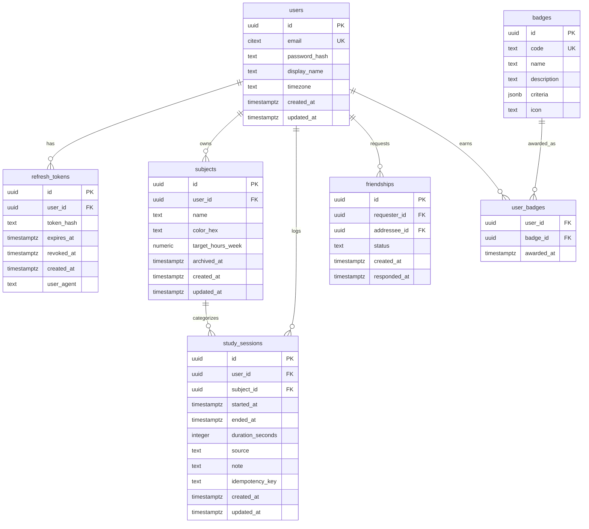

# Especificación de base de datos — StudyLogV2

## 1. Motor

- **Postgres 16/17**.
- ORM: **Drizzle ORM** + `drizzle-kit` para migraciones.
- Desarrollo local: Docker Compose.
- Producción: Neon o Supabase con cadena de conexión pooled.

## 2. Diagrama entidad-relación



## 3. Tablas

### 3.1 `users`

| Columna | Tipo | Restricciones |
|---|---|---|
| `id` | `uuid` | PK, `gen_random_uuid()` |
| `email` | `citext` | UNIQUE, NOT NULL |
| `password_hash` | `text` | NOT NULL |
| `display_name` | `text` | NOT NULL |
| `timezone` | `text` | NOT NULL, default `UTC` |
| `created_at` | `timestamptz` | NOT NULL, default `now()` |
| `updated_at` | `timestamptz` | NOT NULL, default `now()` |

Notas:

- `citext` requiere la extensión `citext`.
- El email se normaliza a minúsculas; `citext` evita duplicados por mayúsculas.
- No se expone `password_hash` en ninguna respuesta.

### 3.2 `refresh_tokens`

| Columna | Tipo | Restricciones |
|---|---|---|
| `id` | `uuid` | PK |
| `user_id` | `uuid` | FK → `users.id`, ON DELETE CASCADE |
| `token_hash` | `text` | NOT NULL, UNIQUE |
| `expires_at` | `timestamptz` | NOT NULL |
| `revoked_at` | `timestamptz` | NULL |
| `created_at` | `timestamptz` | NOT NULL, default `now()` |
| `user_agent` | `text` | NULL |

Notas:

- Solo se guarda el hash del refresh token, nunca el token en claro.
- Rotación: al usar un refresh token, se revoca y se emite uno nuevo.
- Reutilización de un token revocado: revocar toda la familia de tokens del usuario.

### 3.3 `subjects`

| Columna | Tipo | Restricciones |
|---|---|---|
| `id` | `uuid` | PK |
| `user_id` | `uuid` | FK → `users.id`, ON DELETE CASCADE |
| `name` | `text` | NOT NULL, `length(trim(name)) > 0` |
| `color_hex` | `text` | NOT NULL, formato `#RRGGBB` |
| `target_hours_week` | `numeric(5,2)` | NULL, `>= 0` |
| `archived_at` | `timestamptz` | NULL |
| `created_at` | `timestamptz` | NOT NULL, default `now()` |
| `updated_at` | `timestamptz` | NOT NULL, default `now()` |

Notas:

- El color se valida en API y UI; no es la única señal visual.
- Archivar no elimina sesiones.
- Un usuario no puede tener dos asignaturas activas con el mismo nombre (opcional, recomendado).

### 3.4 `study_sessions`

| Columna | Tipo | Restricciones |
|---|---|---|
| `id` | `uuid` | PK |
| `user_id` | `uuid` | FK → `users.id`, ON DELETE CASCADE |
| `subject_id` | `uuid` | FK → `subjects.id`, ON DELETE RESTRICT |
| `started_at` | `timestamptz` | NOT NULL |
| `ended_at` | `timestamptz` | NOT NULL, `> started_at` |
| `duration_seconds` | `integer` | NOT NULL, `> 0`, calculado en servidor |
| `source` | `text` | NOT NULL, `CHECK (source IN ('manual','pomodoro'))` |
| `note` | `text` | NULL, máximo razonable (p. ej. 1000 caracteres) |
| `idempotency_key` | `text` | NULL; UNIQUE `(user_id, idempotency_key)` |
| `created_at` | `timestamptz` | NOT NULL, default `now()` |
| `updated_at` | `timestamptz` | NOT NULL, default `now()` |

Reglas:

- `duration_seconds` se calcula en servidor desde `started_at`/`ended_at`; no se confía en el cliente.
- Validar `ended_at > started_at`.
- Evitar solapamientos por usuario. Si se detecta solapamiento, devolver `409 CONFLICT` o `422 VALIDATION_ERROR` con detalle.
- `subject_id` debe pertenecer al mismo `user_id`.
- `idempotency_key` único por usuario para evitar duplicados al reintentar. La clave vive con la sesión, así que no necesita TTL separado; si se adopta una tabla de idempotencia dedicada, añadir `expires_at` y limpieza.
- Las sesiones archivadas o eliminadas no cuentan en estadísticas.

### 3.5 `friendships`

| Columna | Tipo | Restricciones |
|---|---|---|
| `id` | `uuid` | PK |
| `requester_id` | `uuid` | FK → `users.id`, ON DELETE CASCADE |
| `addressee_id` | `uuid` | FK → `users.id`, ON DELETE CASCADE |
| `status` | `text` | `CHECK (status IN ('pending','accepted','blocked'))` |
| `created_at` | `timestamptz` | NOT NULL, default `now()` |
| `responded_at` | `timestamptz` | NULL |

Reglas:

- `requester_id <> addressee_id`.
- UNIQUE `(requester_id, addressee_id)`.
- No duplicar la relación inversa aceptada; normalizar el par o comprobar ambos sentidos.
- Bloquear elimina o invalida la amistad.

### 3.6 `badges`

| Columna | Tipo | Restricciones |
|---|---|---|
| `id` | `uuid` | PK |
| `code` | `text` | UNIQUE, NOT NULL |
| `name` | `text` | NOT NULL |
| `description` | `text` | NOT NULL |
| `criteria` | `jsonb` | NOT NULL |
| `icon` | `text` | NOT NULL |

### 3.7 `user_badges`

| Columna | Tipo | Restricciones |
|---|---|---|
| `user_id` | `uuid` | FK → `users.id`, ON DELETE CASCADE |
| `badge_id` | `uuid` | FK → `badges.id`, ON DELETE CASCADE |
| `awarded_at` | `timestamptz` | NOT NULL, default `now()` |

Reglas:

- PK compuesta `(user_id, badge_id)` para concesión idempotente.
- Los criterios se evalúan al escribir sesiones o en un job periódico.

### 3.8 Extensiones para Fase 5 (post-MVP)

El contrato social puede ampliar el modelo en su propia migración:

- **`users.leaderboard_visibility`**: `public` | `friends` | `private`, por defecto `friends`. Controla la visibilidad en rankings.
- **`blocks`**: `blocker_id`, `blocked_id`, `created_at`, PK/UNIQUE del par. Impide solicitudes y visibilidad.
- **`user_streaks`**: `user_id`, `current_streak`, `longest_streak`, `last_computed_day`, `updated_at`. Materializa la racha para evitar recalcular el histórico en cada lectura.
- **`leaderboard_weekly`**: vista materializada o tabla de agregados con `user_id`, `week_start`, `total_seconds`, `generated_at`. Se refresca por cron o se cachea con TTL.
- **Separación de solicitudes y amistades**: si se necesita un historial de solicitudes, añadir `friend_requests` (`requester_id`, `addressee_id`, `status`, timestamps) y dejar `friendships` solo para pares aceptados. La alternativa del MVP social es mantener una única tabla `friendships` con estado.

La decisión final se toma en el PR de contrato social antes de implementar la Fase 5.

## 4. Índices

| Tabla | Índice | Motivo |
|---|---|---|
| `study_sessions` | `(user_id, started_at DESC)` | Historial y estadísticas |
| `study_sessions` | `(subject_id)` | Desglose por asignatura |
| `study_sessions` | `(user_id, subject_id, started_at DESC)` | Filtros combinados |
| `study_sessions` | UNIQUE `(user_id, idempotency_key)` | Idempotencia |
| `refresh_tokens` | `(user_id)` | Revocación por usuario |
| `refresh_tokens` | `(token_hash)` UNIQUE | Búsqueda de token |
| `friendships` | `(status)` | Leaderboard de amigos |
| `friendships` | `(requester_id, addressee_id)` UNIQUE | Evitar duplicados |
| `user_badges` | `(user_id)` | Perfil de emblemas |
| `subjects` | `(user_id, archived_at)` | Listado de asignaturas activas |

Para leaderboards, evaluar una vista materializada o tabla de agregados semanales:

```sql
-- Ejemplo conceptual
CREATE MATERIALIZED VIEW weekly_study_hours AS
SELECT
  user_id,
  date_trunc('week', started_at AT TIME ZONE 'UTC') AS week_start,
  SUM(duration_seconds) / 3600.0 AS hours
FROM study_sessions
GROUP BY user_id, week_start;
```

Refrescar con Vercel Cron o job programado; no en cada petición.

## 5. Zona horaria y fechas

- Todo timestamp se guarda en UTC (`timestamptz`).
- Las estadísticas personales y rachas se calculan en la zona horaria del usuario.
- El leaderboard semanal usa una ventana UTC fija para todos.
- Cuidado con DST: usar `date-fns-tz` o equivalente, no restas manuales de horas.
- No usar `timestamp` sin zona horaria.

## 6. Migraciones

- `drizzle-kit generate` para generar migraciones; `drizzle-kit migrate` para aplicarlas.
- Migraciones backward-compatible: expandir → migrar datos → contraer.
- No ejecutar migraciones al arrancar la función serverless.
- Ejecutar en CI o en un paso previo al deploy, con `DATABASE_URL` de producción.
- Toda migración destructiva requiere plan de rollback y backup.

## 7. Datos de demo y tests

- Seed con usuario de prueba, asignaturas y sesiones de ejemplo.
- Los datos de demo de la landing deben estar marcados como demo en la UI.
- Tests de integración usan una base de datos Postgres real en Docker.
- Aislar tests por transacción, esquema o base de datos dedicada.
- Nunca usar datos de producción en tests.

## 8. Privacidad y retención

- El email no se muestra en leaderboards.
- Los rankings muestran nombre visible e identificador público, no email.
- Prever eliminación de cuenta y datos asociados (cascade).
- Documentar retención de refresh tokens y logs.

## 9. Modelo de datos por fase

| Fase | Tablas |
|---|---|
| 1 | `users`, `refresh_tokens`, `subjects` |
| 2 | `study_sessions` (incluye `idempotency_key`) |
| 3 | Sin tablas nuevas; reutiliza `study_sessions` |
| 5 | `friendships`, `badges`, `user_badges`; opcional `user_streaks`, `blocks`, `leaderboard_weekly` (vista o tabla) y `friend_requests` según el contrato social |
| 6 | Sin tablas nuevas; índices, limpieza y verificación de backups |

La migración de cada fase se genera en su rama y se aplica en CI/CD, nunca al arrancar la función serverless.
